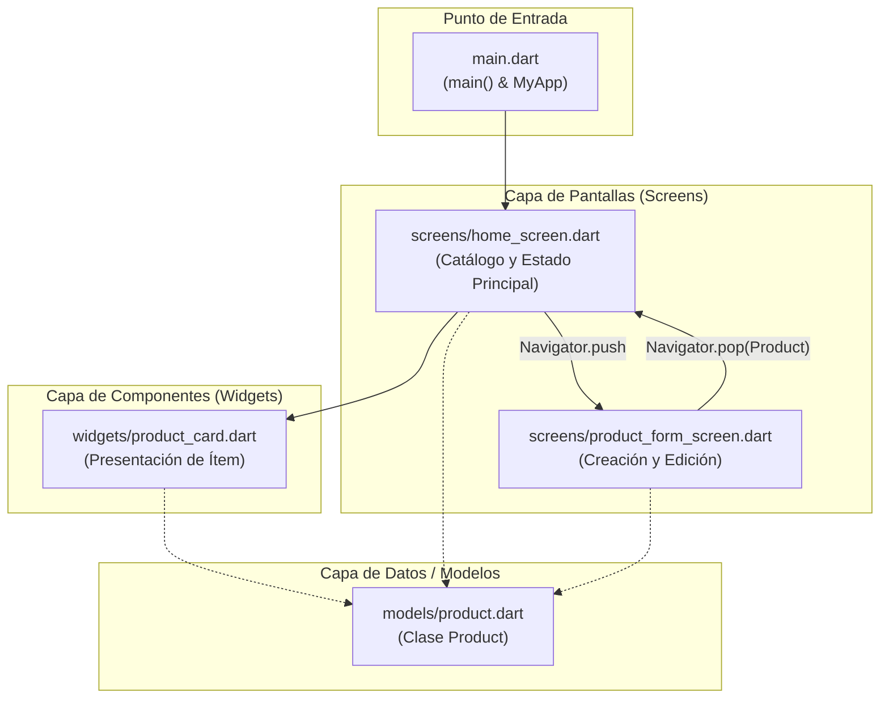
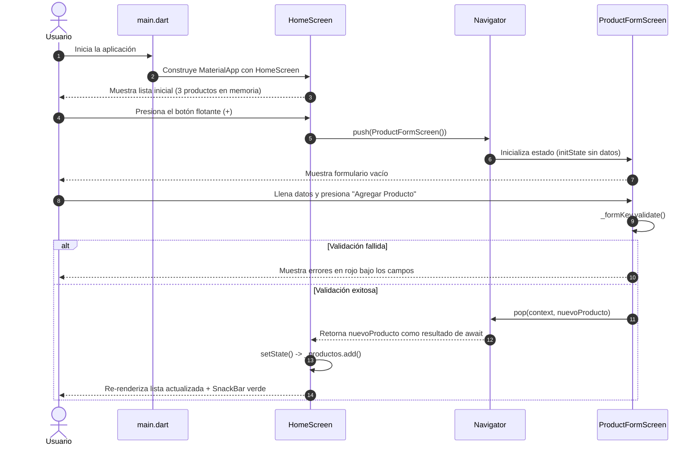

# Documento Técnico de Arquitectura y Flujo del MVP: Gestor de Inventario

**Curso:** Desarrollo de Software IV (UCR - Sede Regional del Pacífico)  
**Proyecto:** Demostración práctica de framework móvil (Flutter)  
**Versión:** 1.0.0 (MVP)

---

## 1. Visión General del Proyecto

El proyecto consiste en una aplicación móvil y multiplataforma desarrollada en **Flutter** bajo un enfoque de **Producto Mínimo Viable (MVP)**. Su objetivo es demostrar los conceptos esenciales del desarrollo con Flutter: punto de entrada, ciclo de vida de widgets, árbol de componentes (widget tree), gestión reactiva del estado local (`setState`), navegación declarativa entre pantallas y manejo de formularios con validación.

### Objetivos Técnicos Cubiertos (Rúbrica DE-01 a DE-06)
- **DE-01 (Ejecutable):** Compila sin errores y corre de forma reactiva en Web y Desktop.
- **DE-02 (Interfaz móvil):** Dispone de dos pantallas desacopladas (`HomeScreen` y `ProductFormScreen`) con navegación de ida y vuelta.
- **DE-03 (Interacción y validación):** Formulario con 4 campos con validación tipada y retroalimentación mediante `SnackBar`.
- **DE-04 (Manejo de datos):** Colección en memoria administrada mediante un CRUD reactivo completo.
- **DE-05 (Explicación técnica):** Código modular organizado en capas (`models`, `screens`, `widgets`).
- **DE-06 (Reproducibilidad):** Documentación clara para instalación de dependencias y ejecución.

---

## 2. Diagrama de Arquitectura y Organización del Código

La solución sigue una arquitectura limpia en capas, manteniendo la separación entre la estructura de datos, la lógica de presentación y los componentes visuales reutilizables.



### Estructura de Directorios
```text
inventory_app/
├── pubspec.yaml               # Configuración del proyecto, SDK y dependencias
├── analysis_options.yaml      # Reglas de linting del compilador de Dart
└── lib/
    ├── main.dart              # Arranque del framework y configuración del tema
    ├── models/
    │   └── product.dart       # Entidad inmutable del dominio
    ├── screens/
    │   ├── home_screen.dart   # Vista principal, listado y lógica CRUD
    │   └── product_form_screen.dart # Vista de captura y validación de datos
    └── widgets/
        └── product_card.dart  # Componente visual para filas del inventario
```

---

## 3. Desglose Componente por Componente

### 3.1. Punto de Entrada: `lib/main.dart`
Es el disparador del motor de Flutter.

- **`void main()`**: Invoca `runApp(const MyApp())`, inicializando el binding de la plataforma y adjuntando el widget raíz a la pantalla.
- **`MyApp` (`StatelessWidget`)**:
  - No mantiene estado mutable propio.
  - Configura el `MaterialApp`: define el título global, deshabilita el banner de depuración (`debugShowCheckedModeBanner: false`) y activa el sistema de diseño **Material 3** mediante `ThemeData(useMaterial3: true)`.
  - Establece a `HomeScreen` como la propiedad `home` (pantalla inicial).

### 3.2. Modelo de Dominio: `lib/models/product.dart`
Define la estructura de datos que representa a un artículo dentro del inventario.

- **Atributos:**
  - `id` (`String`): Identificador único (permite ubicar o eliminar elementos).
  - `nombre` (`String`): Descripción textual del producto.
  - `cantidad` (`int`): Unidades disponibles en stock.
  - `precio` (`double`): Valor monetario unitario.
  - `categoria` (`String`): Clasificación del artículo.
- **Constructor:** Todos los campos son `required` y la clase es inmutable (`final`), lo que previene inconsistencias durante el ciclo de vida del estado.

### 3.3. Componente Reutilizable: `lib/widgets/product_card.dart`
Representa un widget de presentación puro (Stateless).

- **Responsabilidad:** Renderizar un elemento individual de la lista sin conocer de dónde provienen los datos ni cómo se almacenan.
- **Parámetros recibidos:**
  - `producto` (`Product`): Datos a mostrar.
  - `onEdit` (`VoidCallback`): Función disparada al presionar el icono de lápiz.
  - `onDelete` (`VoidCallback`): Función disparada al presionar el icono de basurero.
- **Estructura visual:** Un `Card` envolviendo un `ListTile` estándar con título en negrita, subtítulo informativo y un bloque `trailing` con el precio y los dos botones de acción.

### 3.4. Pantalla Principal: `lib/screens/home_screen.dart`
Es el núcleo de la aplicación; maneja el estado local del catálogo.

- **Tipo:** `StatefulWidget` (su contenido muta a lo largo del tiempo).
- **Estado Local (`_HomeScreenState`):**
  - `_productos` (`List<Product>`): Lista reactiva que almacena los artículos en memoria.
- **Operaciones de Control de Estado:**
  - `_agregarProducto(Product)`: Inserta el nuevo producto en la lista dentro de `setState()` para forzar el re-renderizado (`build`) y notifica al usuario con un `SnackBar`.
  - `_editarProducto(Product)`: Localiza el índice del producto por su ID con `indexWhere()` y lo reemplaza dentro de un bloque `setState()`.
  - `_eliminarProducto(Product)`: Lanza un modal de confirmación `showDialog<void>` con `AlertDialog`. Si el usuario confirma, invoca `removeWhere()` dentro de `setState()`.
  - `_irAFormulario({Product? producto})`: Gestiona la navegación asíncrona hacia `ProductFormScreen` mediante `Navigator.push`. Espera el retorno mediante `await` y ejecuta la adición o edición correspondiente.
- **Renderizado Dinámico:**
  - Si `_productos.isEmpty`, renderiza un texto informativo en el centro.
  - Si hay datos, instancia un `ListView.builder`, el cual optimiza el consumo de memoria renderizando únicamente los ítems visibles en pantalla.

### 3.5. Formulario de Captura: `lib/screens/product_form_screen.dart`
Controla la entrada de datos, la validación y la distinción entre nuevo registro o modificación.

- **Tipo:** `StatefulWidget`.
- **Mecanismos clave:**
  - `_formKey = GlobalKey<FormState>()`: Clave global utilizada para validar y guardar simultáneamente todos los campos del formulario (`_formKey.currentState!.validate()`).
  - `TextEditingController`: Controladores para sincronizar el texto en pantalla con las variables en memoria (`_nombreCtrl`, `_cantidadCtrl`, `_precioCtrl`).
  - `initState()`: Evalúa si `widget.producto` es nulo (modo creación) o contiene datos (modo edición) para precargar los campos.
  - `dispose()`: Libera los controladores de la memoria cuando la pantalla se destruye, evitando fugas de memoria (*memory leaks*).
  - `_guardar()`:
    1. Ejecuta las validaciones de negocio (cadenas no vacías, números enteros válidos y positivos, números decimales positivos y categoría seleccionada).
    2. Si es válido, genera o conserva el ID y devuelve la instancia mediante `Navigator.pop(context, nuevoProducto)`.

---

## 4. Flujo General de Ejecución del Proyecto

El siguiente diagrama de secuencia describe el ciclo de vida completo de una operación de creación y actualización de datos:



---

## 5. Paso a Paso: Ciclo de Datos y Eventos (CRUD)

### Paso 1: Inicialización
1. Flutter ejecuta `main()`.
2. Se compila `MyApp`, aplicando la paleta de colores de Material 3.
3. Se monta `HomeScreen`, instanciando la lista `_productos` con tres elementos por defecto para pruebas inmediatas.

### Paso 2: Creación de un Producto
1. El usuario toca el `FloatingActionButton`.
2. `HomeScreen` invoca `_irAFormulario()`.
3. Se produce una transición de pantalla (`Navigator.push`) hacia `ProductFormScreen`.
4. El usuario ingresa la información y toca **"Agregar Producto"**.
5. Se validan las reglas de negocio (ej. cantidad > 0, precio > 0).
6. Se crea un nuevo `Product` con un identificador único generado por `DateTime.now().millisecondsSinceEpoch`.
7. `Navigator.pop(context, producto)` cierra la pantalla y devuelve el objeto a `HomeScreen`.
8. `_agregarProducto` lo inserta en `_productos` y dispara `setState()`, notificando al framework que debe redibujar la interfaz.

### Paso 3: Edición de un Producto
1. El usuario toca el icono de lápiz en un `ProductCard`.
2. `HomeScreen` ejecuta `_irAFormulario(producto: itemSeleccionado)`.
3. `ProductFormScreen` detecta en `initState()` que el parámetro no es nulo y precarga los valores en los controladores.
4. Al presionar **"Guardar Cambios"**, el formulario conserva el `id` original y devuelve la entidad actualizada.
5. `_editarProducto` encuentra el registro mediante `indexWhere` y lo sobreescribe bajo `setState()`.

### Paso 4: Eliminación de un Producto
1. El usuario toca el icono de papelera.
2. `HomeScreen` despliega un `AlertDialog` solicitando confirmación explícita.
3. Si se presiona **"Cancelar"**, se ejecuta `Navigator.pop(ctx)` sin efectos colaterales.
4. Si se presiona **"Eliminar"**, `removeWhere` extrae el elemento de la lista bajo `setState()`, cerrando el diálogo y mostrando un `SnackBar` de confirmación.

---

## 7. Empaquetado y Despliegue en Android (Estructura del APK)

### 7.1. ¿Qué es un APK y cómo se genera?
El **APK (Android Package Kit)** es el formato de paquete ejecutable utilizado por el sistema operativo Android para distribuir e instalar aplicaciones. 

En Flutter, el proceso de compilación hacia Android no requiere interactuar manualmente con la interfaz de Android Studio, ya que el motor de Flutter orquesta directamente la herramienta de automatización **Gradle**:

1. **Compilación y Transpilación:** Flutter procesa el árbol de widgets y lógica Dart, empaquetando el motor gráfico de Flutter (`libflutter.so`).
2. **Inyección de Manifiesto (`AndroidManifest.xml`):** Define el nombre visible en el teléfono (`android:label="Pequeño Mundo"`), el icono del lanzador (`android:icon="@mipmap/ic_launcher"`) y la actividad principal (`MainActivity`).
3. **Recursos Nativos (`res/mipmap-*/`):** Aloja los iconos adaptativos del sistema en diversas densidades (MDPI, HDPI, XHDPI, XXHDPI, XXXHDPI).
4. **Firma y Empaquetado:** Gradle ensambla el archivo final en un contenedor comprimido firmado (`app-debug.apk` o `app-release.apk`), listo para su instalación en cualquier dispositivo físico.

---

## 8. Puntos Clave para la Exposición y Demostración

Al realizar la presentación de 20–25 minutos, se recomienda estructurar la demostración de la siguiente manera:

1. **Mostrar la Arquitectura (1 minuto):** Enfatizar la separación de carpetas (`lib/models`, `lib/screens`, `lib/widgets`).
2. **Punto de Entrada (2 minutos):** Abrir [main.dart](file:///c:/Users/Usuario/Downloads/UCR/Desarrollo%20lV/Investigación/inventory_app/lib/main.dart) y explicar cómo `MaterialApp` coordina el tema y la primera vista.
3. **Manejo del Estado Reactivo (5 minutos):** Mostrar [home_screen.dart](file:///c:/Users/Usuario/Downloads/UCR/Desarrollo%20lV/Investigación/inventory_app/lib/screens/home_screen.dart), explicando qué hace `setState()` y por qué la UI se actualiza inmediatamente al agregar o borrar un elemento.
4. **Navegación y Paso de Parámetros (5 minutos):** Explicar el uso de `Navigator.push<Product>` con `await` y cómo `ProductFormScreen` devuelve el resultado mediante `Navigator.pop`.
5. **Formulario y Validaciones (4 minutos):** Mostrar [product_form_screen.dart](file:///c:/Users/Usuario/Downloads/UCR/Desarrollo%20lV/Investigación/inventory_app/lib/screens/product_form_screen.dart), el uso de `_formKey`, validadores y el ciclo de vida de los controladores (`initState` y `dispose`).
6. **Demostración en Vivo (3–4 minutos):** Correr la aplicación en vivo con `flutter run -d edge` o `flutter run -d windows` demostrando agregar, editar, borrar y las validaciones de campos erróneos.
